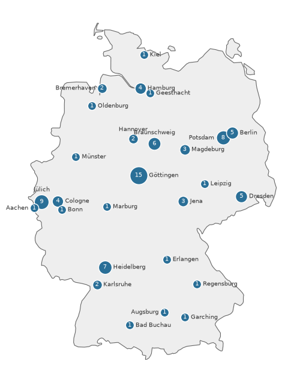
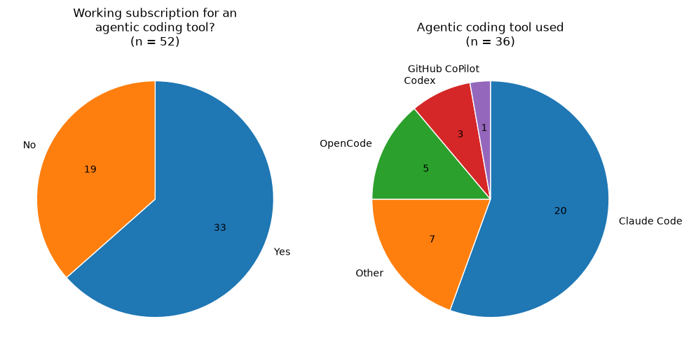
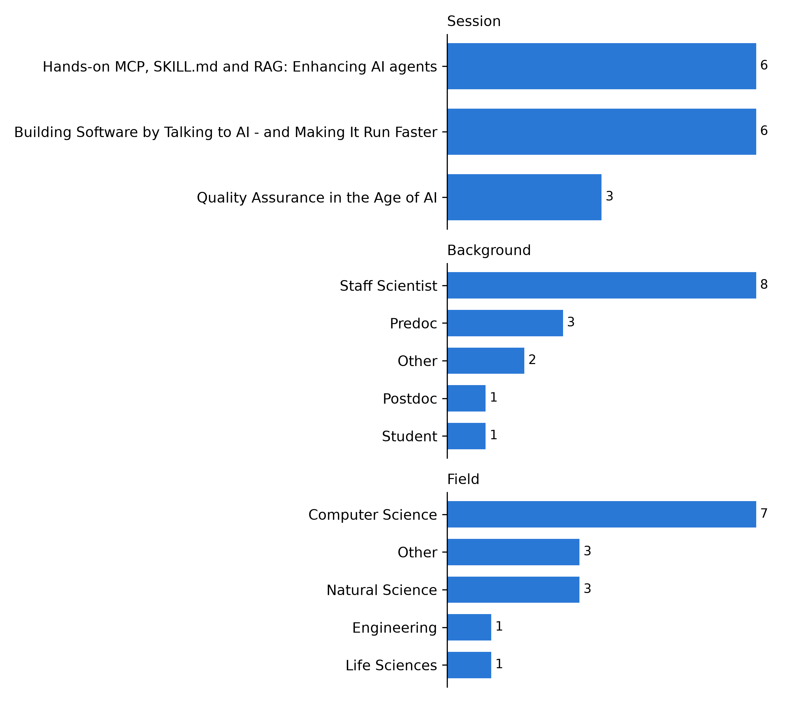
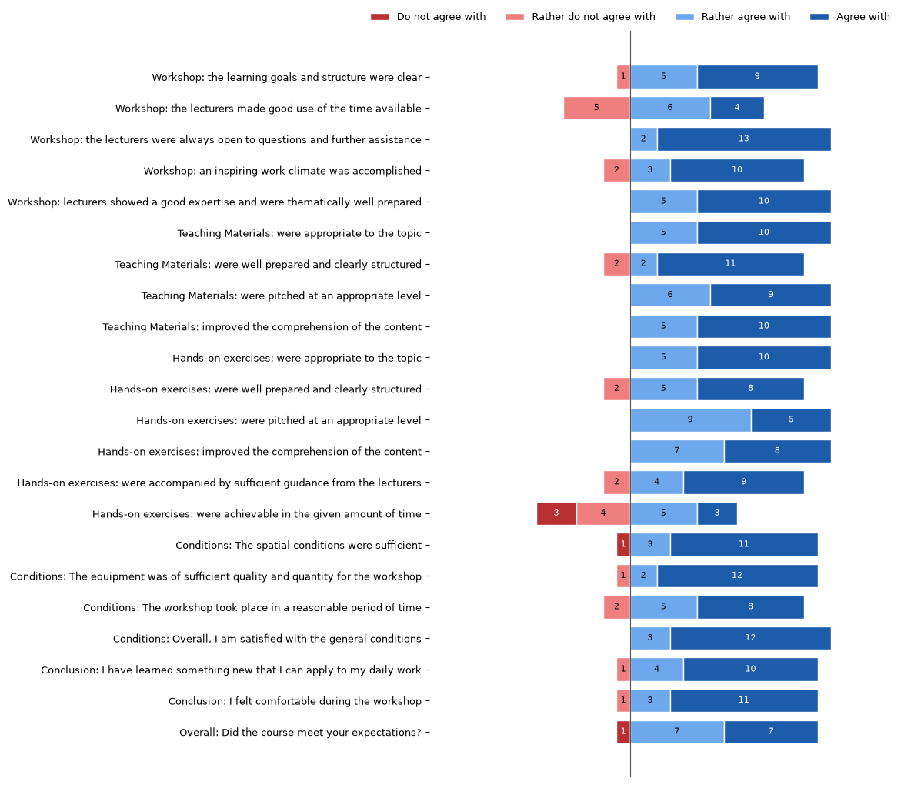
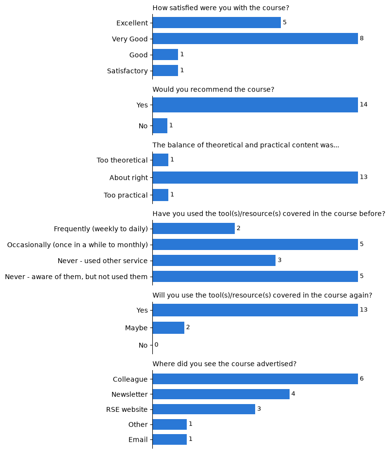
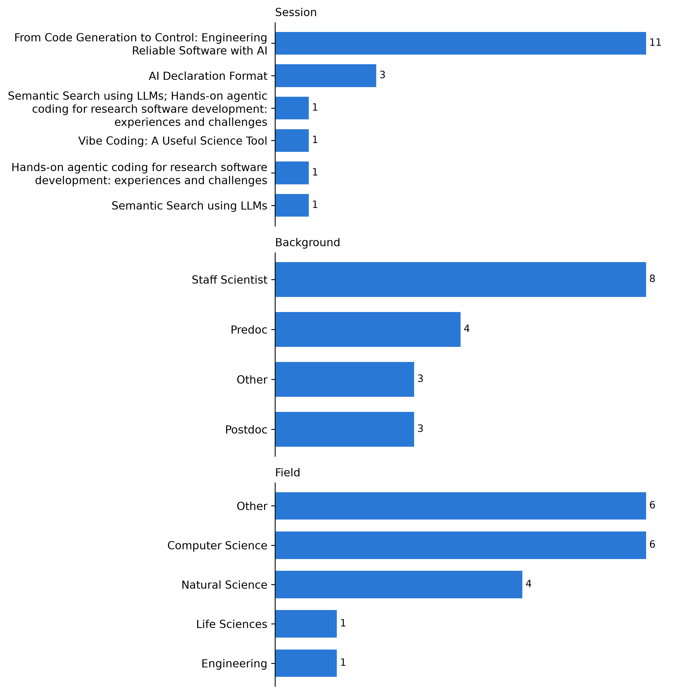
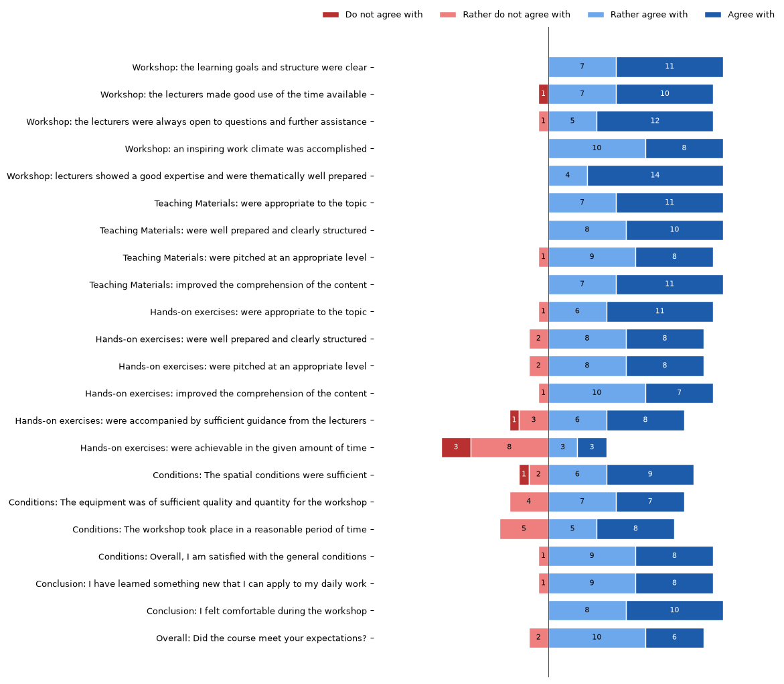
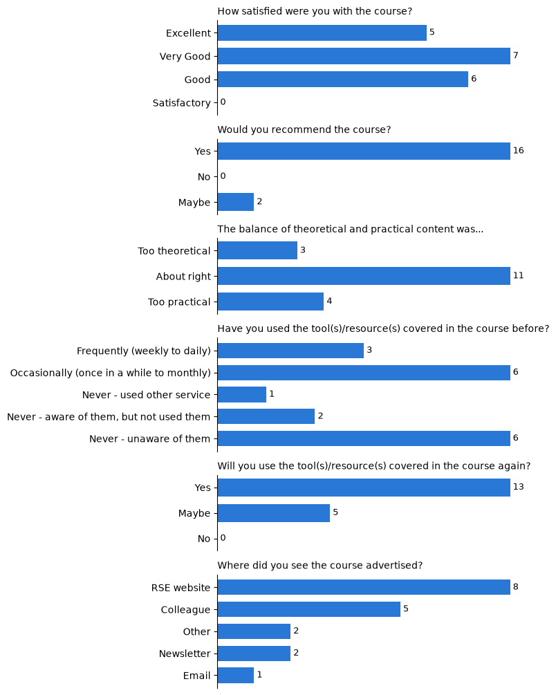

Plan to submit to https://riojournal.com/

# Introduction and context
With the rise of transformer architectures and more and more capable large-language models (LLMs), the development of models specifically trained for coding has progressed at a rapid rate. The GPT 3.0-based Codex model\cite{chen2021evaluating} was one of the first models trained on publicly available repositories, and was used to power GitHub Copilot which launched in June 2021\cite{friedman2021copilot}. Initially, GitHub Copilot mostly served as an autocompletion tool when it became publicly available in June 2022, being able to predict what should come next in the code or make inline suggestions based on comments or prior code / docstrings. The chat functionality supported the tool later to also serve as a knowledge base and interpreter for the user, starting from the end of December 2023. This ensemble worked quite well for the more common coding languages and libraries, but failed when choosing more recent, or not much used libraries or new releases of libraries (since still the old API was present in the models training data). These limitations for example motivated the development of approaches that supply up-to-date documentation at inference time. One example is Context7 \cite{context7}, a Model Context Protocol (MCP) server that retrieves version-specific library documentation.

A significant developmental step in AI-assisted programming was the emergence of Cursor\cite{anysphere2024cursor}, that provided an AI-native integrated development environment (IDE). Cursor extended the AI-powered code completion with more deeply integrated LLM-based assistance in the development workflows, through codebase-aware interactions, code modifications more strongly driven by natural language, and more and more autonomous editing of files. Its rising popularity reflected a broader shift from code completion toward agentic software development.

In 2025, Anthropic's Claude Code\cite{Anthropic} (February 2025) and OpenAI's Codex\cite{openai2025codex} (May 2025) emerged, and quickly gained traction in the community. These tools represent the transition to agentic coding, as they allow the LLM to interact with its environment. They represent the fundamental shift from coding assistant to an AI agent executing development tasks. These tools can autonomously explore codebases, modify multiple files, execute commands, run tests, and iteratively refine their implementations based on the real-world feedback that they directly interpret. 

Meanwhile, new, more capable LLMs are continue to be developed; while the attention has expanded from the models themselves to the software infrastructure or harness in which they are embedded. A model harness can be defined as the software infrastructure surrounding an LLM; orchestrating its interactions with its environment through external tools and execution environments. The harness manages context, tool access and permissions, and enables iterative execution of multi-step tasks through an agent loop, supported by an autonomous interpretation of an actions result leading to further decisions. Together, the model and the harness constitute the AI agent.

The built-in tools that are typically available to an AI agent include file reading, file creation, bash and python commands, for example. Additional tools and external services can be integrated through mechanisms such as the MCP. 

Alongside these developments, models and their harnesses increasingly offer different reasoning and execution modes. Depending on the model and provider, these may allow users to allocate more computational resources to complex reasoning tasks or choose between faster and more thorough problem-solving approaches. Furthermore, agents can be configured to assume specialized roles, such as planning, code implementation, or code review, through tailored instructions, tools, and workflows.

Extending on these proprietary tools and providers, that could potentially lead to a vendor lock-in, alternative approaches emerged with the aim to reduce dependencies on these systems. Services such as OpenRouter (2023) provided unified API access to different models from various providers\cite{openrouter}. Additionally, lightweight and extensible coding-agent harnesses such as Pi\cite{pi2025} (2025) enabled developers to combine different models with customizable agent workflows and tools. This contributed to a more modular combination of interoperable LLMs, agent harnesses, and model providers, offering greater flexibility and control for the developers.

All of these advancements drastically change the way Research Software Engineers (RSEng) carry out their daily work as research software developers. The coding aspect of Research Software Engineering, and partially also the best practices, are now deeply ingrained in the AI agents, shifting the focus somewhat from the programming task itself to planning, requirements elicitation and code review. One major aspect is the task and requirements specification at the right level of detail to achieve a concise, targeted, and optimal solution; instead of a bloated, unfocused and inconsistent codebase. Again, AI agents have become better and better at supporting software development, while also the practices in using them have evolved at the same time. It should be noted that agentic support does not substitute programming expertise, as the RSEngs still need to make architectural decisions and ensure scientific correctness. 

The daily work of an RSEng does not only change by the way the development tasks have shifted, but also because coding capabilities have become much more widely accessible to researchers. Now also technically less experienced users can, with the help of AI agents, develop software to address their research questions. When these agents are used through their harnesses in a local environment, some of the established software engineering best practices are often automatically adopted, such as version control or unit tests for the code, and the generation of software metadata. However, many researchers interact directly through web-based chat interfaces, which compromises the reproducibility of any code-based analysis. In effect, the fundamental software engineering practices that should be taught to scientists are changing, as well as the technical knowledge, expectations, and needed support that RSEngs encounter when collaborating with them.

In response to these multifaceted changes and continued rapid development of the AI-assisted coding, Interest Group 2 (IG2) of the Alliance Focus on Digitality in Science\cite{ig2} and the German Research Software Engineering Association (de-RSE e.V.)\cite{derse} jointly organized a community workshop on AI-assisted Research Software Engineering. IG2 focuses on the development and use of digital tools in science, including artificial intelligence and machine learning; where digital sovereignty, transparency, reproducibility, and software sustainability are main aspects of the alliance. The de-RSE e.V. meanwhile represents the German Research Software Engineering community at the practitioner level, bringing together professionals engaged in developing research software. The workshop aimed to provide a platform for exchanging experiences with AI coding agents, discussing emerging practices and challenges and their implications for Research Software Engineering (RSE). As such, the workshop objectives were to (1) foster a dialog and exchange in the community about these topics, (2) assess the current state-of-the-art including opportunities and challenges, and (3) work towards a shared understanding of the capabilities, limitations and appropriate use of these tools.

To our knowledge, the only other workshop about the impact of agentic coding on RSE in the European region took place in March 2026 in the UK: "Research Software Engineering in the Age of Generative AI: Building a Community Vision", co-led by the Research Software Alliance (ReSA) and funded by a grant from Schmidt Sciences. This invitation-only workshop brought together experts to discuss the implications of generative AI for Research Software Engineering and develop guiding principles for the community\cite{barker2026research}. In addition, the joint lab Helmholtz Information – Research Software Engineering (HiRSE) organized the seminar series "Summer of AI for RSE", in which community members gave talks on topics such as ethics, training, AI-generated pull requests in open-source projects, and research data management tools\cite{hirseseminar2026}.

While the UK workshop focused on developing a strategic community vision and the HiRSE series presented individual perspectives on AI in RSE in a lecture format, the workshop presented here aimed to facilitate a grassroots, broader practitioner-level exchange. By combining talks with hands-on sessions, it encouraged in-depth discussion among participants.

The purpose of this report is to document an overview of the current state of the field, including practical experiences; and the discussions, emerging best practices and key outcomes of the workshop. The report seeks to provide a foundation for future community-driven initiatives, training activities, and the development of best practices for AI-assisted Research Software Engineering.

# Program

The program was structured around tangible and quantitative topics, such as practical sessions how to use these tools, together with the essential legal, ethical and security aspects. The incentive was to target a practical route, and discuss experiences with this, instead of focusing on derived aspects such as digital sovereignity, mental load and how RSE work changes. Therefore, the program was organized around five keynote sessions, representing the different main aspects of the field: Ethical, legal and security aspects, and usability aspects with their impact on research. The practical sessions were grouped in two tracks, **A** for beginners in agentic coding and **B** for the more advanced topics. 

With the experience levels given in the registration, this fit quite well as roughly half rated their level as "Beginner" and the other half as "Advanced". In the **A** sessions, the basics how to use coding agents and different workflows were presented, where in **B**, software verification, validation, and agent customization were shown with the help of hands-on examples. All materials are available online\cite{hifis2026workshop}. [Should this be moved to zenodo, how long will it persist?]. The keynote talks were also recorded and are available at []. Below listed are the keynote talks and hands-on sessions together with their abstracts and links.

## Keynote talks and abstracts
 
1. **The Ethical Dimensions of Employing AI-based Technologies** (Hermann Diebel-Fischer, ScaDS.AI Dresden/Leipzig and TU Dresden): Since generative AI has entered the stage, many things have changed.
This change, however, does not come for free. While using AI-based technologies for software development, coding, code review, and testing does seem to make these processes more efficient, we must bear in mind that outsourcing activities which formerly were done mainly by humans will affect important areas: trustworthiness, reliability, and responsibility. In my talk, I will discuss the ethics of relying on AI tools and the possible consequences that may arise from the employment of AI tools in software engineering.
2. **How are scientists adopting AI coding tools?** (Elle O’Brien, University of Michigan): Programming is essential to modern scientific research, yet most scientists report inadequate training for the software development their work demands. Generative AI tools capable of code generation may support scientific programmers, but user studies indicate risks of over-reliance, particularly among inexperienced users. We surveyed 868 scientists who program, examining adoption patterns, tool preferences, and factors associated with perceived productivity. Adoption is highest among students and less experienced programmers, with variation across fields. Scientific programmers overwhelmingly prefer general-purpose conversational interfaces like ChatGPT over developer-specific tools. Both inexperience and limited use of development practices (like testing, code review, and version control) are associated with greater perceived productivity—but these factors interact, suggesting formal practices may partially compensate for inexperience. The strongest predictor of perceived productivity is the number of lines of generated code typically accepted at once. These findings suggest scientific programmers using generative AI may gauge productivity by code generation rather than validation.
3. **Integrated Science Environments: Usability in HPC as the Final Frontier** (Lars Quentin, GWDG): Usability is a critical driver of productivity in high-performance computing (HPC). Yet, researchers frequently encounter steep learning curves, struggling with complex system architectures and the underlying computer science knowledge required to run domain-specific experiments. In this session, Prof. Kunkel will outline key strategies for enhancing
HPC usability and explore how artificial intelligence can streamline experiment orchestration and data analysis. Drawing inspiration from modern software development environments, Integrated Science Environments (ISEs) shift the focus toward researcher-centric design, empowering scientists to concentrate on their core questions rather than infrastructure. After an impulse presentation, we will discuss the future together. Join us to discover how the next generation of HPC tools is making advanced computing more accessible, intuitive, and impactful.
4. **Software rights in times of AI** (Tobias Schlauch, DLR): It is currently unclear who holds the rights to AI-generated code. What exactly does this mean for me if, for example, I use LLMs for code generation? And can I prepare for the time when this is finally clarified? In this talk, we will outline the current state of the debate surrounding the rights to AI-generated code, the additional challenges that exist, and the measures AI companies are taking to address them. Finally, we would like to discuss with you how we can currently use AI-generated code but also be prepared for when the debate reaches a conclusion.
5. **Insecure by design? A human-centric security perspective on AI-assisted software development** (Magdalena Glas): Generative artificial intelligence (AI) tools are increasingly used in software development, improving the efficiency of software developers. However, this adoption introduces notable security challenges. AI/generated code is not secure by default, as it is often based on large-scale training data that includes open-source code of varying quality and trustworthiness. Developers using these tools may be unaware of the associated risks or may place excessive trust in the security of the output. This talk outlines the key security risks associated with generative AI and offers human-centered strategies for mitigation. Since these risks arise not only from how generative AI models are built but also from how humans interact with them, we adopt a human-centric perspective. To this end, we provide recommendations for individuals, organizations, and educators to help harness the potential of generative AI in software development while effectively managing the associated security risks.

## Hands-on sessions

1. **A1 Building Software by Talking to AI - and Making It Run Faster** (Jaison Lewis, Anja Gerbes, GWDG): This joint workshop brings together two complementary perspectives on AI-assisted software development: building software from scratch using natural language, and optimising existing code using LLM-powered performance analysis. The first session introduces complete beginners to agentic coding using Opencode and SAIA. Participants will learn to direct an AI agent using plain language, plan a project with a reasoning model, and leave with a fully structured project ready to build — no coding experience required. The second session introduces PASCIT (Performance Analysis and Source Code Instrumentation Toolsuite), a framework that uses LLMs to profile, instrument, and automatically optimise research software. Participants will analyse real computational kernels, generate and compare optimised code, and run closed-loop auto-optimisation with hardware performance counters — gaining measurable, empirically validated speedups within the session. Together, the two sessions cover the full arc of modern AI-assisted software work: from describing an idea in plain language and scaffolding a project, to profiling and optimising the code that results. Participants leave with practical experience of both workflows and a clear picture of how AI tools can support researchers and developers at every stage of the software lifecycle.
2. **A2 Gemini as a Coding Assistant and Debugging Collaborator Using AMERH Framework** (Eman A. M. Amer): As Generative AI (GenAI) becomes increasingly integral to software development, instructional priorities should shift toward training students to use large language models (LLMs) as interactive tutors rather than solely as code generators. This workshop presents AMERH (Ask, Museful, Evaluate, React, and Chain/Refine), a structured framework grounded in Vygotsky’s Zone of Proximal Development (ZPD). The AMERH framework aims to enhance students' programming competencies and address issues arising from copy-paste practices that hinder critical thinking. The workshop positions learners as active participants in their educational process. I will introduce the AMERH Framework as a structured methodology for writing effective prompts, followed by a hands-on coding example that demonstrates how to leverage AMERH to learn programming, such as Python, and utilize AI as an assistant, debugger, and collaborator.
3. **B1 Quality Assurance in the Age of AI** (Harald Mack, Tuyen Le, SSC): One promise implicit in the current AI hype cycle is that AI transforms tasks from requiring intent, expertise and skill into requiring only intent and a tool. However, experience in engineering tells us that under constraint intent is not enough, and that for all tools, a solid engineering approach is needed to ensure quality and reliability. With agentic AI rapidly becoming ubiquitous, the need for solid principles and workflows to verify and validate these systems. In science, this becomes especially important because it often deals with unique problems and previously unknown patterns and questions. This increases the stakes of AI failure, and thus the need for validation and verification (“are we building the right product” and “are we building the product right”). In this contribution, we will focus on verification, and identify a number of failure modes of AI in scientific contexts. We propose a set of approaches to quality assurance and verification to mitigate them, covering testing, architecture, documentation and auditability, and will work on them practically. Given the fast moving field, participants are invited to contribute their own experiences and approaches to quality assurance in the context of AI in science, aiming for an active exchange of ideas and best practices.   
4. **B2 Hands-on MCP, SKILL.md and RAG: Enhancing AI agents** (Inga Ulusoy, Sára Veselá): Large language models (LLMs) are the foundation for AI agents, which constitute software systems with planning, reasoning and decision-making capabilities. By providing access to specialized resources, agents can be enhanced through MCPs (model-context protocol\cite{anthropic2024mcp}), skills\cite{agentskills2025} or RAG (retrieval-augmented generation\cite{lewis2020retrieval}). MCPs provide a standardized protocol to supplement AI agents with tools. Key principle of an MCP is the decoupling of tool providers - the MCP server - from the agent capabilities. This allows multiple MCPs to work together or supply a larger software system that is composed of AI agents. On the other hand, AI agents can be supplemented with skills. Skills are declared through SKILL.md files that allow a progressive disclosure of the agent's context. As such, skills provide additional resources to the AI agent as needed. In this hands-on session, we will show how to use MCPs and skills, and which technique serves which purpose. We will also show how this expands on RAG technology with examples.
5. **A3 AI Declaration Format and AI agent skills for Research Software Engineering** (Faruk Diblen, eScience center): 
Generative AI is transforming Research Software Engineering , but it also introduces critical challenges for scientific integrity, reproducibility, and software sustainability. As open science policies and regulations like the EU AI Act evolve, transparently tracking the provenance of AI-generated code is shifting from a best practice to a strict requirement. In this 90-minute hands-on workshop, we will tackle AI transparency in research workflows using the AI Declaration Format\cite{aideclaration2026} - -a lightweight, machine-readable standard designed to document AI involvement directly within your codebase. We will also use a pack of AI coding agent skills\cite{diblen2026rseng} to maintain the AI declaration file.
What you will do:
- Understand the Stakes: Learn why AI provenance is critical for reproducible science and mitigating the "maintenance debt" of black-box code generation.
- Get Hands-On: Create, validate, and integrate your own AI declarations into a sample repository using the aidecl CLI tool and Web App.
- Shape the Standard: We are actively developing this framework! Throughout the session, we will collect your feedback and ask for your ideas on how to improve the current format and tooling to better serve the RSE community.
- install and use rseng-agent-skills, a pack of research software engineering skills your coding agent applies by itself, so the declaration is maintained automatically
- Both projects are in active development, and we would like to get your feedback.
6. **A4 Vibe Coding: A Useful Science Tool** (Till Korten): A hands-on session on vibe coding and AI coding agents. It introduces coding agents that work largely autonomously to implement features, fix bugs, and write documentation. Topics include web-based coding workflows using GitHub issues and pull requests, best practices for prompting agents, writing maintainable code, and the strengths and limitations of coding agents for scientific software development.
7. **B3 Semantic Search using LLMs** (Alexander Schlemmer, IndiScale): Searching semantic data management systems and knowledge graphs is a challenging endeavour. Prevalent semantic query languages like SPARQL are difficult to learn and therefore pose a high barrier to widespread adoption among non-technical users. Large language models  (LLMs) provide a promising way to enable researchers without advanced skills in SPARQL or other domain-specific search languages to perform specific data queries that can be used for subsequent analysis and automation. We have developed an LLM-based query interface for the open-source semantic data management system LinkAhead. Its main component is a translator that converts natural language into LinkAhead's domain-specific query language, CQL. The component can be used with a variety of open-source, open-weight, or proprietary LLMs. Hallucination risks are mitigated through a combination of constrained query generation and human-in-the-loop verification. A graphical interface enables users to inspect generated queries in a structured form before execution, reducing the likelihood of incorrect queries being sent to the LinkAhead backend. This workshop will introduce the design and architecture of the LLM-based translator. Furthermore, we will present validation results and discuss limitations.
7. **B3 Hands-on agentic coding for research software development: experiences and challenges** (Allard Oelen, TIB):
In this session, we explore practical experiences with agentic coding in the context of research software development at the TIB - Leibniz Information Centre for Science and Technology. Through real-world examples, we demonstrate how agentic approaches support the full development lifecycle, from rapid prototyping to production-ready feature implementation. Topics include agents, agent instructions, MCPs, skills, etc. We will share our experiences regarding workflows, challenges, and best practices for integrating agentic coding into research-driven software projects. Finally, we will explore how the recent developments in agentic coding have already reshaped our workflows and are likely to do so even more in the future.
8. **B4 From Code Generation to Control: Engineering Reliable Software with AI** (Edwin Carreno, Maxim Scheremetjew): AI-assisted development increases productivity by accelerating code generation; however, it introduces uncertainty in quality, control, and accountability, particularly as large volumes of generated artifacts exceed human capacity for effective review. Without principled integration, these risks can undermine software reliability. This hands-on session introduces a unified, constraint-driven and verification-oriented workflow for integrating AI across the Software Development Life Cycle, grounded in explicit separation of human-critical and AI-supported activities and in the principle that AI-generated artifacts must be validated against formalized requirements prior to integration. Participants will apply techniques for requirement-driven validation, traceability enforcement, and stage-wise verification, ensuring that human oversight governs critical decisions while AI supports generation. The session delivers a reproducible and systematic framework for leveraging AI while preserving reliability, accountability, and engineering rigor.

# Participant demographics

The participant demographics where mostly RSEngs from German higher education and research institutions (88), as well as two from the USA, two from the Netherlands, and one from Czech Republic. The participants from Germany came from all over the country, with a slight dominance of Göttingen and Jülich.

Caption: Distribution of participants from Germany over the country.

Upon registration, participants were also asked to note their experience level, with the options "None", "Beginner", "Advanced", "Expert". 

| None | Beginner | Advanced | Expert |
| -- | -- | -- | -- |
| 12 | 37 | 39 | 5|

The experience level shows a fairly flat distribution, with an almost equal number of "Beginner" and "Advanced" level given.

Before the workshop, a survey was conducted with participants asking them to indicate the tools that they use for AI coding. The results are given in the figure below. Of the 52 respondents, roughly 2/3 already had a subscription. The respondents that have a subscription mostly use Claude Code, clearly dominating the responses with 20 users out of 36 responses. One user said that they did not have a subscription but stated they would use Codex, which is not available for free. Two respondents who had no subscription said they used OpenCode, which is available for free.

Caption: Use of coding tools among a subgroup of participants (52 answers in total). Most respondents already had access to a tool, with a preference for Claude Code.

## Participant interest 
Upon registration, participants were asked to rate their interest in specific tracks. The results are shown in the tables below.

| Track day 1 | Votes |
| -- | -- |
| **B1** Quality Assurance in the Age of AI	| 35 |
| **B2** MCP, Skills and RAG for different applications	| 27 |
| **A1** Building Software by Talking to AI -and Making It Run Faster	| 22 | 
| **A2** Gemini as a Coding Assistant and Debugging Collaborator Using AMERH Framework | 4 |
| no preference given | 17 |
Caption: Of the 93 participants, 8 indicated more than one preferred session, so the votes sum to 105 without the abstantions.

| Track day 2 | Votes |
| -- | -- |
| **B4** From Code Generation to Control: Engineering Reliable Software with AI | 40 |
| **B3** Semantic Search using LLMs plus Hands-on agentic coding for research software development | 23 |
| **A3** AI Declaration Format | 15 |
| **A4** Vibe Coding: A Useful Science Tool | 8 |
| no preference given | 19 |
Caption: Of the 93 participants, 11 indicated more than one preferred session, so the votes sum to 105 without the abstantions.

The actual session participant numbers were not recorded during the event. Overall, the interest in the advanced topics was higher than in the beginner topics, also reflecting that there is a slight bias of the participants' experience level towards a higher level.

# Participant feedback
The participant feedback was overall very positive, however only 15 responses were obtained for day 1 and responses for day 2.

## Day 1: Sessions A1, A2, B1, B2

On day one, each six of the respondents participated in sessions A1 and B2, and three in session B1. Mostly these were staff scientists or before their doctorate, with a background in computer science of natural sciences.

Caption: Feedback form respondents background.

The overall feedback over these three sessions was predominantly positive, with the respondents agreeing that learning goals were clear, were well prepared and appropriate to the topic. The only slightly more negative rating is obtained for exercises achievable in the given amount of time. This was already apparent to most contributors from the beginning, and the materials were designed such that respondents can complete the exercises later in their own time - solutions were provided together with the exercises. Nevertheless, this is an aspect that cannot be overlooked.

Caption: Overall feedback on the sessions and materials of the 15 respondents.

Additional overall feedback was collected, asking for overall satisfaction with the session (very positive), almost all respondents recommending the course (except 1), and a good balance of theoretical and practical content. Most respondents have not used the tools or concepts before the session, and were confident that they would continue to use them. 

Caption: Additional feedback questions for day 1.

The survey respondents could also provide a free-text feedback. This mostly resulted in comments that there was not enough time (3) and that also social aspects should have been included (1). Respondents particularly liked the sample code and instructions, and that there was also space for people who are LLM skeptical or cautious. Respondents commented that their goals in participating in the sessions were achieved.

## Day 2: Sessions A3, A4, B3, B4

On day two, 11 of the respondents participated in session B4, three in A3,  and each one in sessions A4 and B3. Mostly these were staff scientists or before their doctorate, with a background in computer science of natural sciences, and other which was not further specified.

Caption: Feedback form respondents background.

The overall feedback over these sessions was again  predominantly very positive. Again the only negative rating is obtained for exercises achievable in the given amount of time, and this time also for an alloted reasonable amount of time and sufficient guidance from the lecturers.

Caption: Overall feedback on the sessions and materials of the 18 respondents.

The additional overall feedback for overall satisfaction was again very positive, almost all respondents recommending the course (except 2), and a good balance of theoretical and practical content. Many respondents have not used the tools or concepts before the session, and were confident that they would continue to use them (13). 

Caption: Additional feedback questions for day 1.

In the free-text feedback, respondents noted that some more guidance with the materials would have helped, and more time with walkthroughs presenting the solutions. Respondents liked the teaching material and resources that were provided.

# Core discussions and outcomes
[notes for each session]

# Retrospective and recommendations
Repeat the event with updated state-of-the-art, continue with community engagement, make it longer?

# Metadata

AI use in the preparation of the manuscript:
AI was used for proofreading and discussing concepts, and for the evaluation of the demographic and feedback data.

Competing interests

funding

acknowledgements

# Conclusions 
